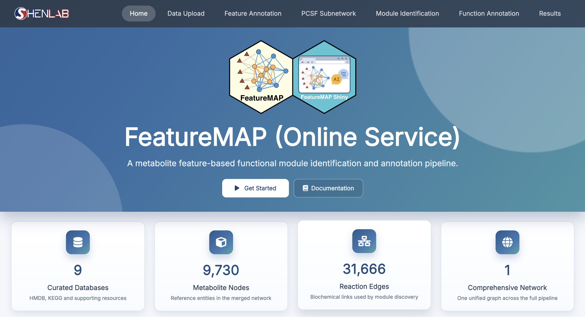

# Installation {#sec-shinyapp_installation}

**FeatureMAP Shiny** is the interactive web interface for the FeatureMAP workflow. It allows users to complete feature annotation, subnetwork extraction, module identification, and module annotation through a point-and-click interface, without writing the full R pipeline manually.

{fig-align="center" width="750"}

There are two ways to use FeatureMAP Shiny:

1.  **R installation**: install the `featuremapshiny` package locally and launch it from R
2.  **Web access**: open the hosted Shiny app in a browser once the server deployment is available

## R Installation

Before installing the Shiny package, make sure the package manager tools are available:

```{r}
#| eval=FALSE

if (!requireNamespace("BiocManager", quietly = TRUE)) {
  install.packages("BiocManager")
}

if (!requireNamespace("remotes", quietly = TRUE)) {
  install.packages("remotes")
}
```

Install the upstream dependencies required by `featuremapshiny`:

```{r}
#| eval=FALSE

if (!requireNamespace("masstools", quietly = TRUE)) {
  remotes::install_github("tidymass/masstools")
}

if (!requireNamespace("massdataset", quietly = TRUE)) {
  remotes::install_github("tidymass/massdataset")
}

if (!requireNamespace("metid", quietly = TRUE)) {
  remotes::install_github("tidymass/metid")
}

if (!requireNamespace("metpath", quietly = TRUE)) {
  remotes::install_github("tidymass/metpath")
}

if (!requireNamespace("PCSF2", quietly = TRUE)) {
  remotes::install_github("ytwangZero/PCSF2")
}
```

Then install the Shiny package itself from GitHub:

```{r}
#| eval=FALSE

remotes::install_github(
  "tidymass/featuremap_shiny",
  dependencies = TRUE,
  repos = BiocManager::repositories(),
  upgrade = "ask"
)
```

::: callout-tip
**How to Launch the Shiny App**

1.  In an R session, run: `featuremapshiny::run_featuremap()`
2.  An R viewer window will open where you can start the workflow. You can also use the **Open in Browser** button to launch it in your default web browser.
3.  You can stop the app at any time by closing the browser tab/window or pressing the stop button in your R IDE.
:::

## Web Access {#sec-web}

A hosted, browser-based instance of FeatureMAP Shiny is planned for users who prefer not to manage a local R environment. The service will provide the same point-and-click interface as the local Shiny application and will require no installation.

**Planned Access URL:** <https://www.shen-lab.org/featuremap_shiny>

::: callout-note
The workflow described in the following Shiny chapters applies to both the local `featuremapshiny` package and the future hosted web deployment.
:::

Once you install the FeatureMAP shiny successfully, continue to next step.
