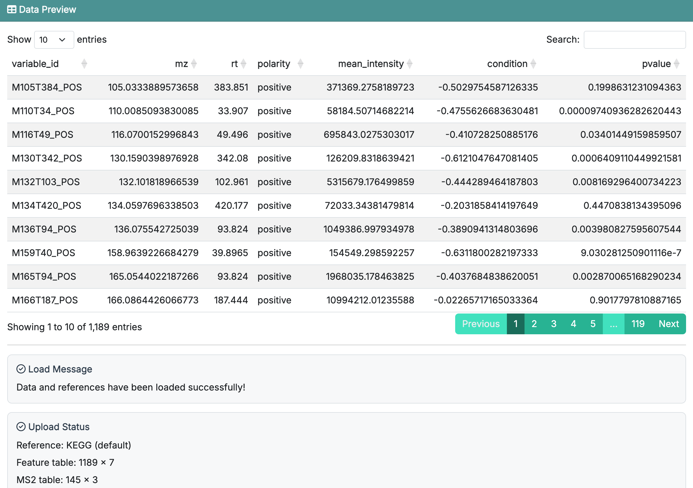

# Data Preparation

This chapter focuses on how to **use** the first part of **FeatureMAP Shiny** rather than repeating all data-format details from the R package tutorial. If you need the full input specification, please refer to [R package-Data Preparation](02_data_preparation.qmd), especially @sec-input_data_requirement.

::: callout-important
**Prerequisites:** Make sure `featuremapshiny` has been installed as described in @sec-shinyapp_installation.
:::

## Start From Home Page

Launch the app with:

```{r}
#| eval: false

featuremapshiny::run_featuremap()
```

When the app opens, you will first see the **Home** page. In the center of the page, there are two main buttons:

-   **Get Started**: jump directly to **Data Upload**, which is the first analysis step
-   **Documentation**: open the FeatureMAP Shiny documentation repository in your browser

{fig-align="center" width="750"}

Here we click the button `Get Started` to start the analysis pipeline.

## Data Upload Page

**Data Upload** is **Step 1** of the workflow. This page is mainly divided into two areas:

-   **Parameter area** on the left: choose the reference database, upload files, and click **Load**
-   **Result area** on the right: preview the loaded feature table and check the loading status

{fig-align="center" width="750"}

## What You Need to Provide

Compared with the R package tutorial, the main points to remember here are:

-   a **feature table** is required
-   an **MS2 annotation table** is optional
-   you need to choose either **HMDB** or **KEGG** as the reference database
-   you can use either the built-in reference data or upload your own reference datasets

The current Shiny app accepts uploaded data tables in:`.csv`, `.rda`, and `.RData`.

For detailed column definitions of `feature_table` and `ms2_table`, see [R package-Data Preparation](02_data_preparation.qmd).

## Recommended: Start with Demo Data

For most users, the best way to learn the app is to start with the built-in demo data.

The recommended sequence is:

1.  choose **HMDB** or **KEGG**
2.  click **Use Demo Data**
3.  keep **Default reference (recommended)** unless you specifically want to test custom references
4.  click **Load**
5.  confirm that the preview table and status message appear on the right

{fig-align="center" width="750"}

This lets you move through the full Shiny workflow first, before switching to your own dataset.

::: callout-tip
After clicking **Use Demo Data**, the app only stages the demo files. You still need to click **Load** to actually place them into the current session.
:::

## Next Step

Once the data are loaded successfully, click **Next Step** to continue to **Feature Annotation**.
