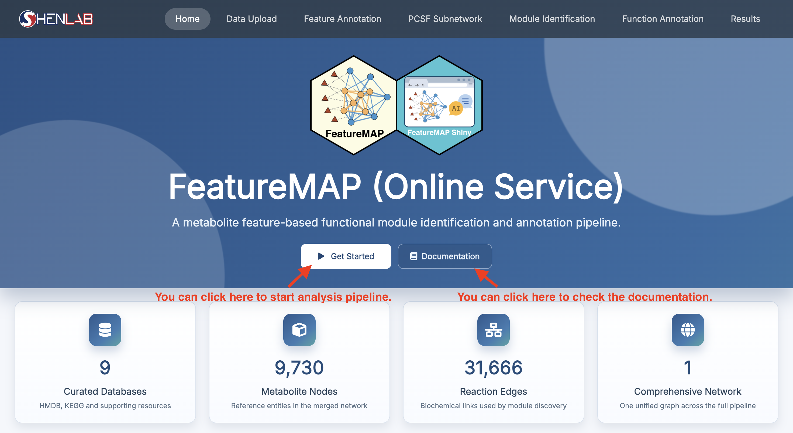
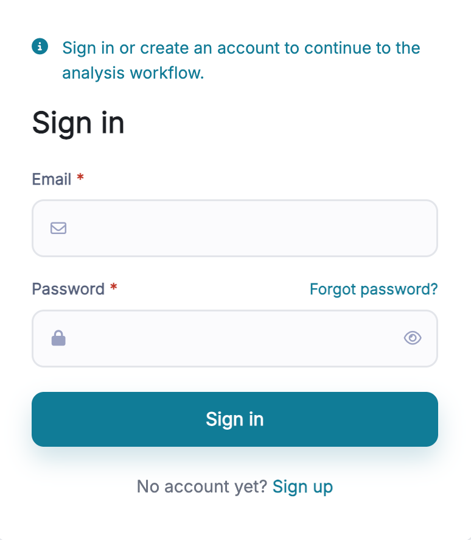
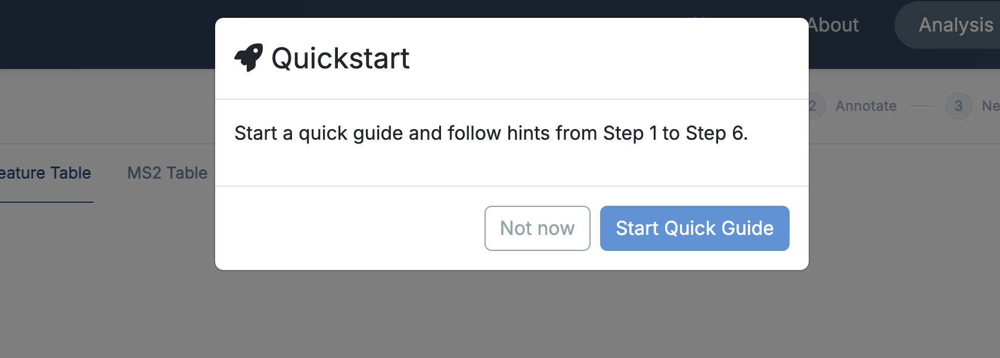
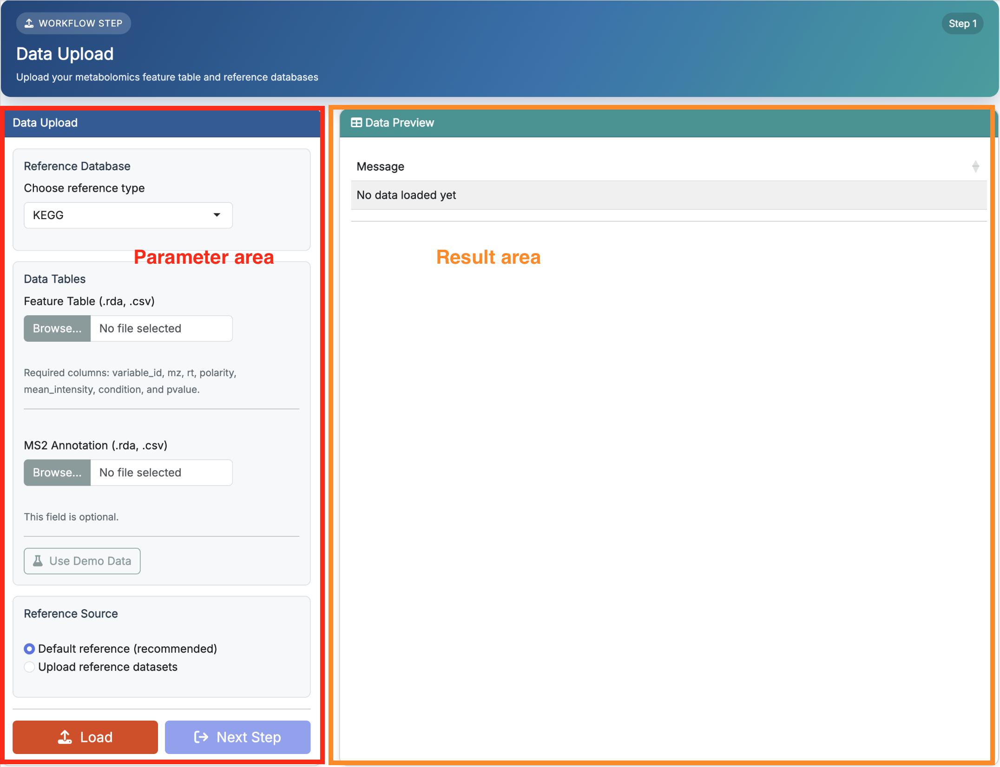
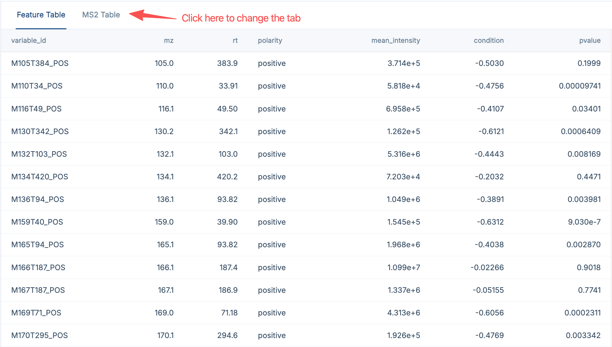

# Data Upload

This chapter focuses on how to **use** the first step of **FeatureMAP Shiny** rather than repeating all data-format details from the R package tutorial. If you need the full input specification, please refer to [R package-Data Preparation](02_data_preparation.qmd), especially @sec-input_data_requirement.

::: callout-important
**Prerequisites:** Make sure `featuremapshiny` has been installed as described in @sec-shinyapp_installation.
:::

## Start From Home Page

Launch the app with:

```{r}
#| eval: false

featuremapshiny::run_featuremap()
```

When the app opens, you will first see the **Home** page. In the center of the page, there are two main buttons:

-   **Get Started**: jump directly to **Data Upload**, which is Step 1 of the workflow
-   **Documentation**: open this tutorial in your browser

{fig-align="center" width="750"}

Here we click the button `Get Started` to start the analysis pipeline.

::: callout-note
On the hosted deployment the analysis pages are protected. If authentication is enabled, clicking **Get Started** takes you to the **Sign In** page first; after signing in, the app returns to the page you were heading for.

{fig-align="center" width="300"}
:::

## Quick Guide

The first time you reach **Data Upload**, the app offers a short guided tour:

{fig-align="center" width="500"}

-   **Start Quick Guide** highlights three spots on every step page in turn -- the parameter sidebar, the **Run** button, and the result panel -- and follows you from Step 1 to Step 6.
-   **Not now** dismisses it; you can still read every parameter's explanation from the ⓘ icons next to the field labels.
-   While the guide is running, use **Next** to move to the next hint and **Exit Guide** to leave it at any time.

## Data Upload Page

**Data Upload** is **Step 1 of 6**. Like every analysis page, it is divided into two areas:

-   **Parameter area** on the left: upload your files, choose the reference source, and click **Load**
-   **Result area** on the right: preview the loaded tables in the **Feature Table** and **MS2 Table** tabs, and check the loading message

{fig-align="center" width="750"}

## What You Need to Provide

Compared with the R package tutorial, the main points to remember here are:

-   a **feature table** is required
-   an **MS2 annotation table** is optional
-   you can keep the **built-in reference resources** or upload your own

The app accepts `.csv`, `.rda` and `.RData` files, up to 500 MB per file by default.

::: callout-important
Choosing between an HMDB and a KEGG namespace is no longer needed. FeatureMAP now uses one **built-in merged database** that keeps both HMDB and KEGG identifiers, exactly as described in [R package-Feature Annotation](03_feature_annotation.qmd).
:::

### Reference Source

-   **Default reference (recommended)**: use the MS1 annotation database and the metabolic reaction network that ship with the app.
-   **Upload reference datasets**: two extra upload fields appear, for your own **MS1 Annotation Database** (`.rda`, a `metid`-compatible database whose `spectra.info` contains `Lab.ID`, `Compound.name`, `Formula`, `HMDB.ID`, `KEGG.ID`, `CAS.ID`, `mz`, `RT` and `Submitter`) and your own **Metabolic Reaction Network** (`.rda`, an `igraph` object). Format examples can be downloaded from [featuremap_resources](https://github.com/tidymass/featuremap_resources).

For detailed column definitions of `feature_table` and `ms2_table`, see [R package-Data Preparation](02_data_preparation.qmd).

## Recommended: Start with Demo Data

For most users, the best way to learn the app is to start with the built-in demo data.

The recommended sequence is:

1.  click **Use Demo Data** -- the two upload fields are filled with `demo_feature_table.rda` and `demo_ms2.rda`
2.  keep **Default reference (recommended)**
3.  click **Load**
4.  confirm that the preview tables and the success message appear on the right

{fig-align="center" width="750"}

This lets you move through the full Shiny workflow first, before switching to your own dataset.

::: callout-tip
**Use Demo Data** only stages the demo files; you still need to click **Load** to place them into the current session. **Download Demo** saves the same two tables as a zip file, which is handy as a template for formatting your own data.
:::

## Next Step

Once the data are loaded successfully, the **Next Step** button becomes available. Click it to continue to **Feature Annotation**.
