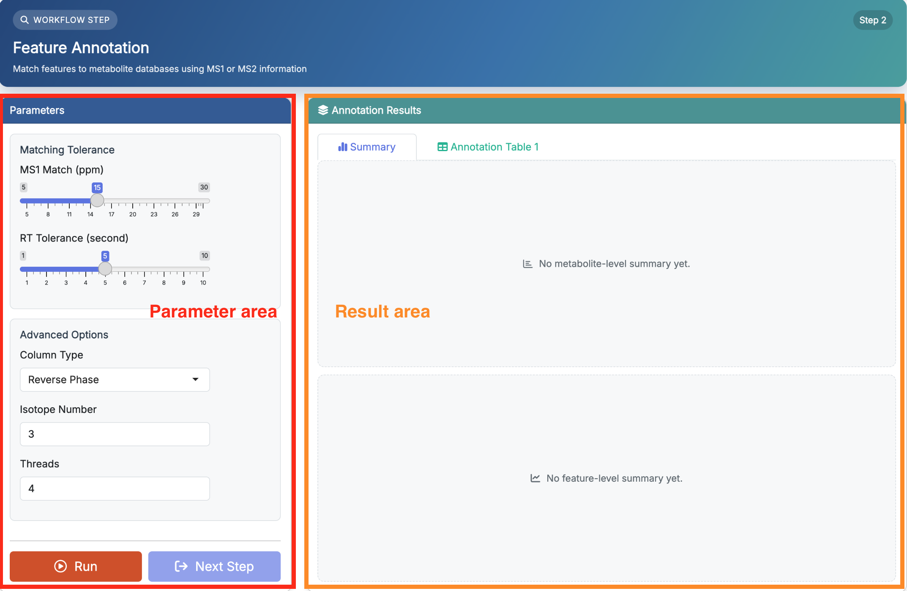
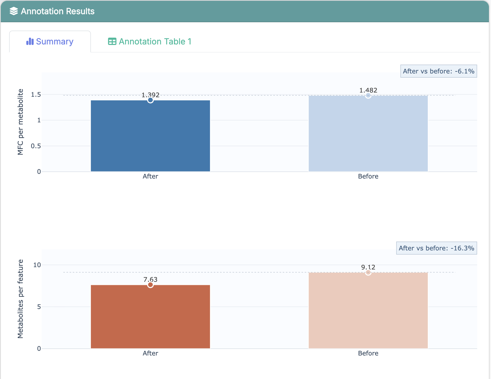
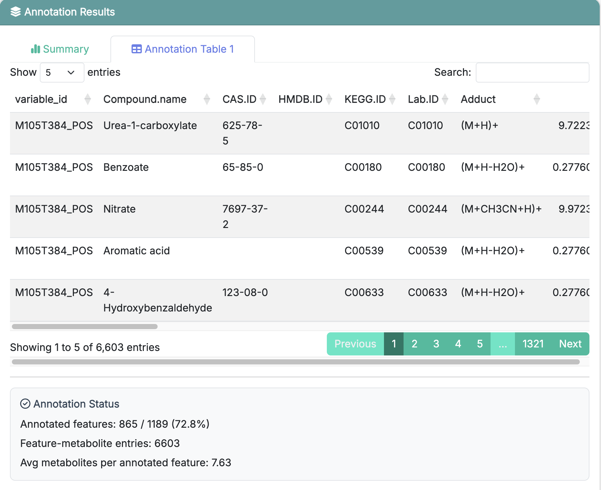

# Feature Annotation

This chapter focuses on how to use **Step 2: Feature Annotation** in **FeatureMAP Shiny**. The detailed method, parameter definitions, and output structure have already been introduced in [R package-Feature Annotation](03_feature_annotation.qmd), so here we focus on the app workflow itself.

::: callout-important
**Prerequisites:** Make sure your data have been loaded successfully in **Data Upload** before starting this step.
:::

## Enter the Feature Annotation Page

After finishing **Data Upload**, click **Next Step**, or open **Analysis → 2 Feature Annotation** in the navigation bar.

{fig-align="center" width="750"}

The purpose of this step is to map metabolomics features to candidate metabolites and prepare the refined annotation table for downstream network analysis.

## Parameter Area

The left panel groups the annotation parameters into two sections:

| Section | Field | Default |
|------------------------|------------------------|------------------------|
| **Matching Tolerance** | MS1 match (ppm) | `15` |
|  | RT tolerance (second) | `5` |
| **Advanced Options** | Column type (Reverse Phase / HILIC) | `Reverse Phase` |
|  | Isotope number | `3` |
|  | Threads | `4` |

The meaning of each parameter is the same as in [R package-Feature Annotation](03_feature_annotation.qmd), and the ⓘ icon next to each section title repeats the short version inside the app.

::: callout-note
If you are running the demo data for the first time, it is usually best to keep the default settings and run the step once before tuning anything.
:::

## Run Feature Annotation

Once the parameters are ready, click **Run**.

A progress card appears while the step is running. When it finishes, the card reports:

-   **Annotated features** -- how many of the uploaded features received at least one candidate, with the percentage
-   **Feature-metabolite pairs** -- how many annotation rows were produced

The result panel on the right is updated automatically and the **Next Step** button becomes available.

If you did not provide an MS2 annotation table in the previous step, the app will still run using MS1-based annotation only.

## Result Area

### Summary

The **Summary** tab reports how much annotation ambiguity was removed by the refinement stage, comparing the state **before** and **after** filtering along two axes:

-   **Candidate metabolites per feature** -- how many metabolites a single feature is still assigned to
-   **Feature groups per metabolite** -- how many metabolite feature clusters (MFCs) point at the same metabolite

{fig-align="center" width="750"}

This view is useful for checking whether the annotation step completed normally and whether the refinement reduced redundancy.

### Annotation Table

The **Annotation Table** tab contains the detailed feature-to-metabolite annotation results produced by this step; it is the same table as `res$anno_feature_table1` in the R package.

{fig-align="center" width="750"}

For a full explanation of the result columns, see [R package-Feature Annotation](03_feature_annotation.qmd). The table supports searching, sorting, and column filtering directly in the browser.

## Recommended: Run the Demo Data First

If you followed the previous chapter and loaded the built-in demo data, the recommended workflow here is:

1.  keep the default parameter settings
2.  click **Run**
3.  wait for the annotation step to finish
4.  check the **Summary** tab first
5.  then open **Annotation Table** to inspect the detailed annotation results

This is the easiest way to understand what the step produces before applying it to your own dataset.

::: callout-tip
If the result table looks empty, first check whether **Data Upload** finished successfully in the previous step, and then confirm that the input files were loaded correctly.
:::

## Next Step

Once feature annotation is complete, click **Next Step** to continue to **PCSF Subnetwork**.
