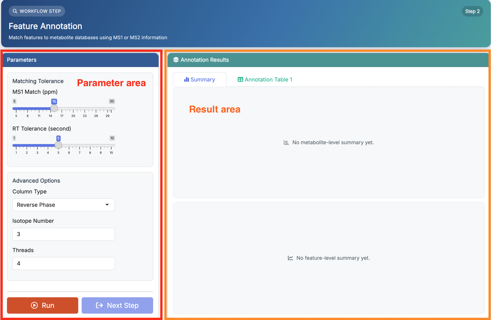
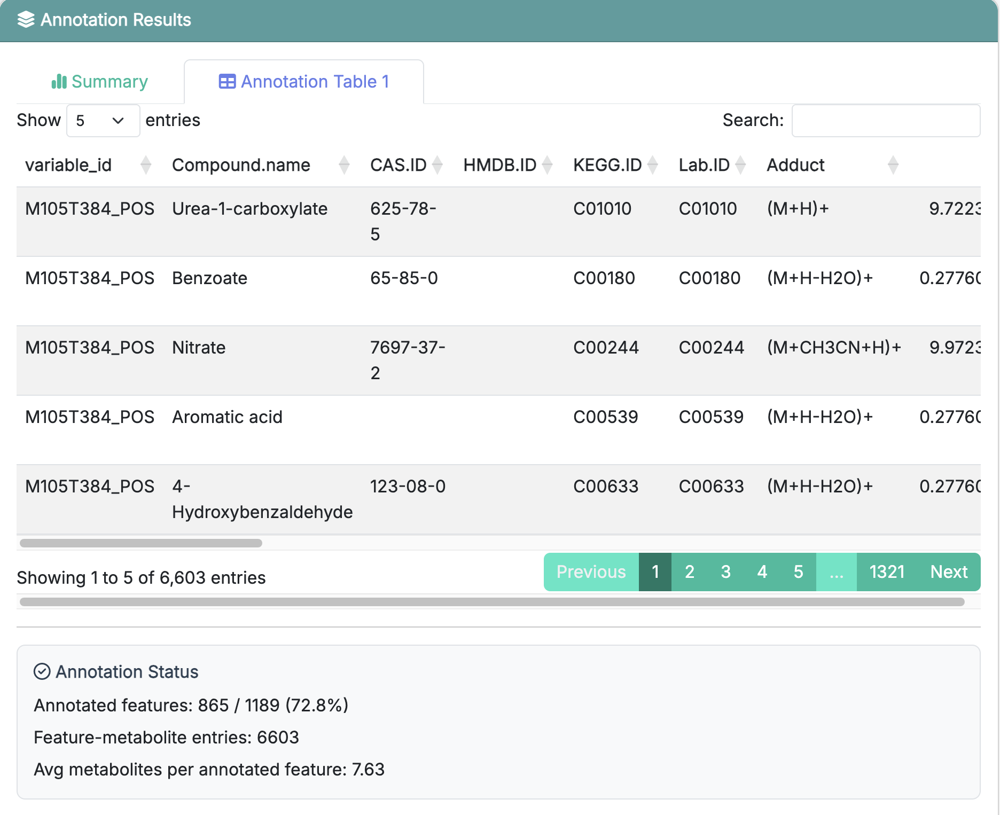

# Feature Annotation

This chapter focuses on how to use **Step 2: Feature Annotation** in **FeatureMAP Shiny**. The detailed method, parameter definitions, and output structure have already been introduced in [R package-Feature Annotation](03_feature_annotation.qmd), so here we focus on the app workflow itself.

::: callout-important
**Prerequisites:** Make sure your data have been loaded successfully in **Data Upload** before starting this step.
:::

## Enter the Feature Annotation Page

After finishing **Data Upload**, click **Next Step** or select **Feature Annotation** from the top navigation bar.

This page is also divided into two areas:

-   **Parameter area** on the left: set annotation parameters and click **Run**
-   **Result area** on the right: view the annotation summary and detailed result table

{fig-align="center" width="750"}

The purpose of this step is to map metabolomics features to candidate metabolites and prepare the refined annotation table for downstream network analysis.

## Parameter Area

The left panel is where you set the feature annotation parameters before clicking **Run**. Since the detailed meanings of these parameters have already been introduced in [R package-Feature Annotation](03_feature_annotation.qmd), we do not repeat them here.

::: callout-note
If you are running the demo data for the first time, it is usually best to keep the default settings and run the step once before tuning anything.
:::

## Run Feature Annotation

Once the parameters are ready, click **Run**.

The app will start the feature annotation procedure and show a running-status modal. When the step finishes successfully, the result panel on the right will be updated automatically, and the **Next Step** button will become available.

If you did not provide an MS2 annotation table in the previous step, the app will still run using MS1-based annotation only.

## Result Area

### Summary

The **Summary** tab gives a quick overview of the annotation results. It mainly helps you see how the annotation changed before and after refinement at both the metabolite level and the feature level.

{fig-align="center" width="750"}

This view is useful for checking whether the annotation step completed normally and whether the refinement reduced redundancy.

### Annotation Table 1

The **Annotation Table 1** tab contains the detailed feature-to-metabolite annotation results produced by this step.

{fig-align="center" width="750"}

For a full explanation of the result columns, see [R package-3 Feature Annotation](03_feature_annotation.qmd).

Below the table, the app also shows an **Annotation Status** summary, including:

-   how many features were annotated
-   how many feature-metabolite entries were produced
-   the average number of metabolite candidates per annotated feature

## Recommended: Run the Demo Data First

If you followed the previous chapter and loaded the built-in demo data, the recommended workflow here is:

1.  keep the default parameter settings
2.  click **Run**
3.  wait for the annotation step to finish
4.  check the **Summary** tab first
5.  then open **Annotation Table 1** to inspect the detailed annotation results

This is the easiest way to understand what the step produces before applying it to your own dataset.

::: callout-tip
If the result table looks empty, first check whether **Data Upload** finished successfully in the previous step, and then confirm that the selected reference database and input files were loaded correctly.
:::

## Next Step

Once feature annotation is complete, click **Next Step** to continue to **Subnetwork Extraction**.
