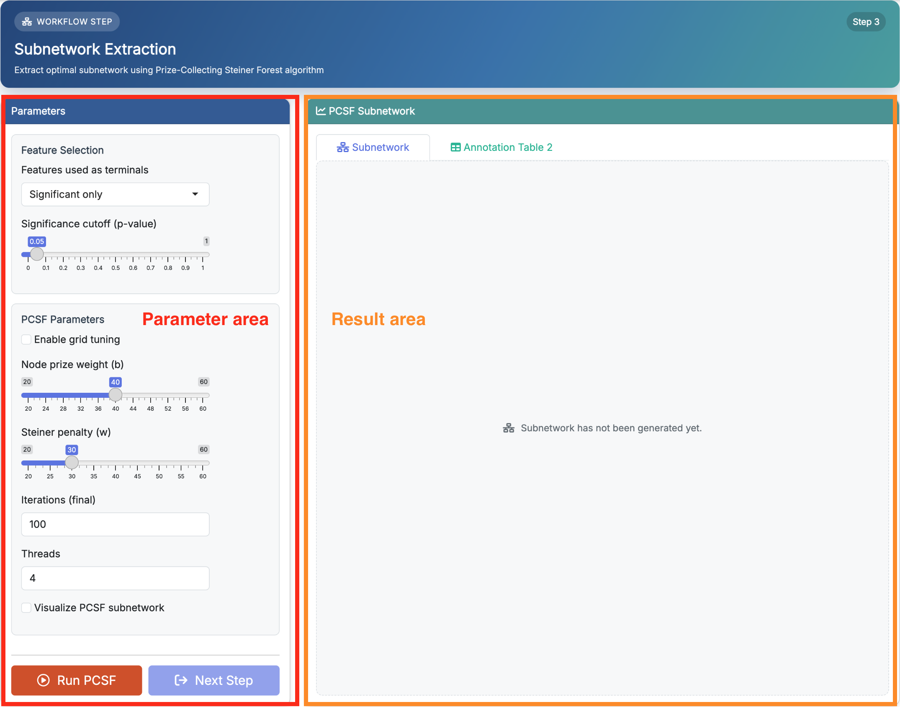
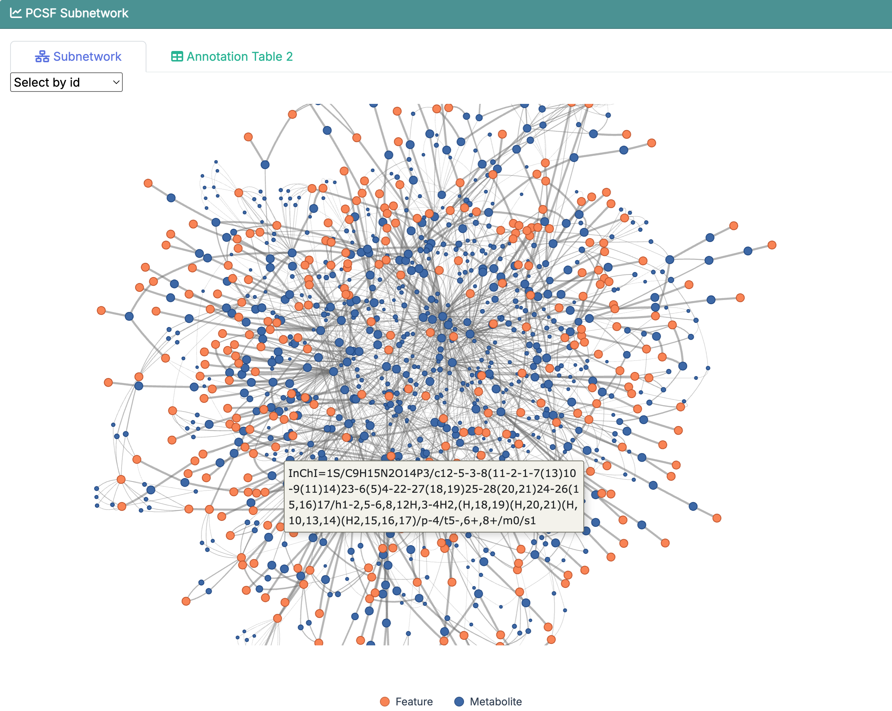
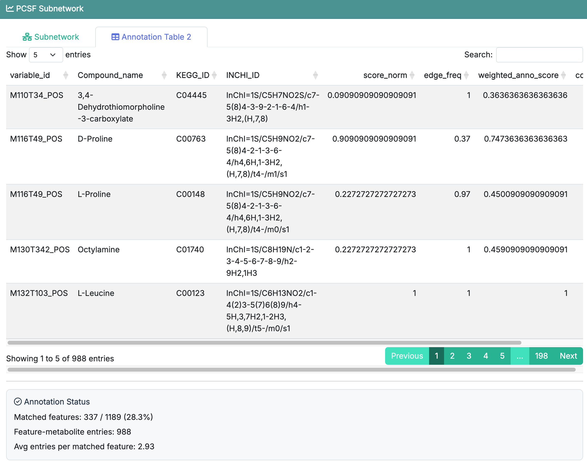

# Subnetwork Extraction

This chapter focuses on how to use **Step 3: PCSF Subnetwork** in **FeatureMAP Shiny**. The detailed method, parameter definitions, and result structure have already been introduced in [R package-Subnetwork Extraction](04_pcsf_subnetwork.qmd), so here we focus on the Shiny workflow itself.

::: callout-important
**Prerequisites:** Make sure **Feature Annotation** has finished successfully before starting this step.
:::

## Enter the PCSF Subnetwork Page

After finishing **Feature Annotation**, click **Next Step**, or open **Analysis → 3 PCSF Subnetwork** in the navigation bar.

{fig-align="center" width="750"}

The purpose of this step is to use the PCSF strategy to extract a network-supported metabolite subnetwork for downstream module identification.

## Parameter Area

| Section | Field | Default |
|------------------------|------------------------|------------------------|
| **Feature Selection** | Features used as terminals (Significant only / All features) | `Significant only` |
|  | Significance cutoff (p-value), shown for *Significant only* | `0.05` |
| **PCSF Parameters** | Enable grid tuning | off |
|  | Node prize weight (b) | `20` |
|  | Steiner penalty (w) | `25` |
|  | Grid tuning range: b min / max / step, w min / max / step | `20 / 40 / 5` |
|  | Iterations (final) | `100` |
|  | Iterations (grid tuning) | `10` |
|  | Threads | `4` |
|  | Visualize PCSF subnetwork | on |

When **Enable grid tuning** is off, you set `b` and `w` directly; when it is on, those two fields are replaced by the grid ranges and by the tuning-iteration field. The meaning of each parameter is the same as in [R package-Subnetwork Extraction](04_pcsf_subnetwork.qmd).

::: callout-note
If you are running the demo data for the first time, it is usually best to keep the default settings, leave grid tuning off, and run the step once before changing anything.
:::

## Run PCSF Subnetwork Extraction

Once the parameters are ready, click **Run PCSF**.

The app shows a progress card while the repeated PCSF runs are executed. When the step finishes successfully, the result panel on the right is updated automatically and the **Next Step** button becomes available.

If you enable **grid tuning**, the selected best `b / w` combination is recorded and shown later in the **Analysis Parameters** card on the **Results Download** page.

## Result Area

### Subnetwork

The **Subnetwork** tab shows the extracted PCSF network, provided **Visualize PCSF subnetwork** was enabled in the parameter area. If visualization is disabled, the run still finishes normally, but this tab stays empty.

{fig-align="center" width="750"}

The network is interactive: you can zoom, drag and click nodes. Two selectors above the plot help you navigate a large network:

-   the **Feature** selector highlights a chosen LC--MS feature and its directly connected metabolites
-   the **Metabolite** selector highlights a chosen metabolite and its directly connected features

The rows listed under the network follow the current selection. The legend distinguishes **Feature** nodes (orange) from **Metabolite** nodes (blue).

### Annotation Table 2

The **Annotation Table 2** tab contains the network-refined annotation results generated after PCSF extraction, that is `res$anno_feature_table2` in the R package. Compared with the previous annotation table, it adds the network evidence (`edge_freq`, `weighted_anno_score`, `confidence_rank`) and is the main output carried into the next step.

{fig-align="center" width="750"}

For a full explanation of the result columns, see [R package-Subnetwork Extraction](04_pcsf_subnetwork.qmd).

## Recommended: Run the Demo Data First

If you followed the previous chapters and loaded the built-in demo data, the recommended workflow here is:

1.  keep the default parameter settings
2.  leave **Enable grid tuning** unchecked for the first run
3.  keep **Visualize PCSF subnetwork** enabled if you want to see the network directly
4.  click **Run PCSF**
5.  check the **Subnetwork** tab first
6.  then open **Annotation Table 2** to inspect the refined results

This is the easiest way to understand what the PCSF step produces before tuning parameters on your own dataset.

::: callout-tip
If the result tab stays empty, first check whether **Feature Annotation** finished successfully in the previous step. Note that repeated PCSF runs are the slowest part of the workflow: lowering **Iterations (final)** gives a quicker first look, at the cost of robustness.
:::

## Next Step

Once subnetwork extraction is complete, click **Next Step** to continue to **Module Identification**.
