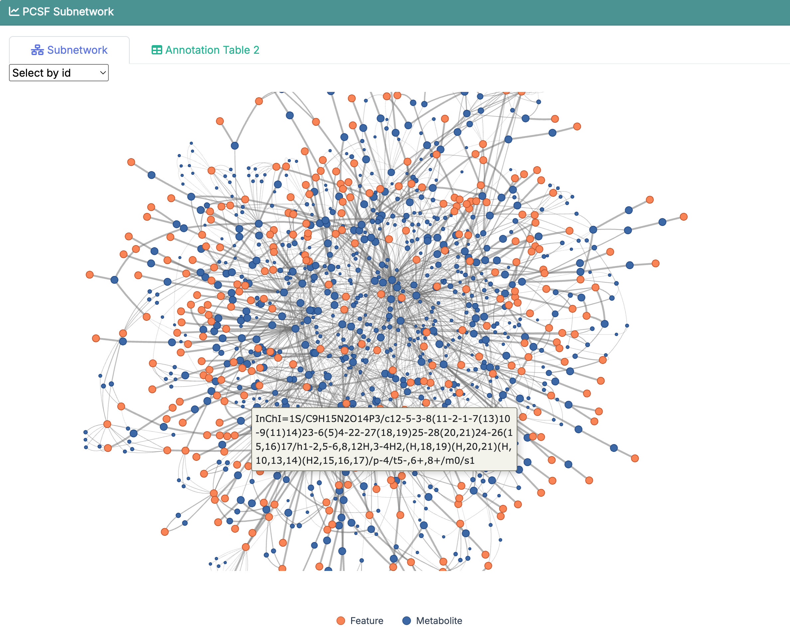
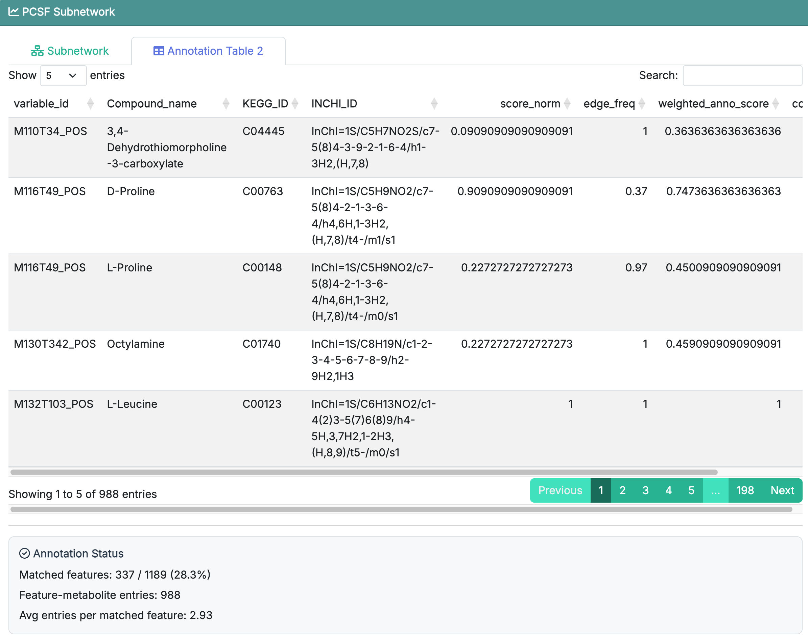

# Subnetwork Extraction

This chapter focuses on how to use **Step 3: Subnetwork Extraction** in **FeatureMAP Shiny**. The detailed method, parameter definitions, and result structure have already been introduced in [R package-Subnetwork Extraction](04_pcsf_subnetwork.qmd), so here we focus on the Shiny workflow itself.

::: callout-important
**Prerequisites:** Make sure **Feature Annotation** has finished successfully before starting this step.
:::

## Enter the PCSF Subnetwork Page

After finishing **Feature Annotation**, click **Next Step** or select **PCSF Subnetwork** from the navigation bar. This page is also divided into two areas:

-   **Parameter area** on the left: set the subnetwork extraction options and click **Run PCSF**
-   **Result area** on the right: inspect the extracted subnetwork and the refined annotation results

{fig-align="center" width="750"}

The purpose of this step is to use the PCSF strategy to extract a network-supported metabolite subnetwork for downstream module identification.

## Parameter Area

The left panel is where you set the PCSF-related parameters before clicking **Run PCSF**. Since the detailed meanings of these parameters have already been introduced in [R package-Subnetwork Extraction](04_pcsf_subnetwork.qmd), we do not repeat them here.

::: callout-note
If you are running the demo data for the first time, it is usually best to keep the default settings, leave grid tuning off, and run the step once before changing anything.
:::

## Run PCSF Subnetwork Extraction

Once the parameters are ready, click **Run PCSF**.

The app will start the PCSF subnetwork extraction procedure and show a running-status modal. When the step finishes successfully, the result panel on the right will be updated automatically, and the **Next Step** button will become available.

If you enable **grid tuning**, the app will additionally report the selected best parameter combination after the run finishes.

## Result Area

### Subnetwork

The **Subnetwork** tab is used to inspect the extracted PCSF network. If **Visualize PCSF subnetwork** is enabled in the parameter area, this tab will show the network plot directly in the app. If visualization is disabled, the run can still finish normally, but the plot area will remain empty.

{fig-align="center" width="750"}

::: callout-tip
This network plot is interactive in the Shiny app. You can zoom, drag, and click nodes to explore the subnetwork in more detail.
:::

When grid tuning is enabled, the best selected parameter combination is also shown in this tab after the analysis is complete.

### Annotation Table 2

The **Annotation Table 2** tab contains the network-refined annotation results generated after PCSF extraction. Compared with the previous annotation table, this table reflects the additional support from the extracted subnetwork and is the main output that will be carried into the next step.

{fig-align="center" width="750"}

For a full explanation of the result columns, see [R package-Subnetwork Extraction](04_pcsf_subnetwork.qmd).

Below the table, the app also shows an **Annotation Status** summary, including:

-   how many features were matched in the refined table
-   how many feature-metabolite entries were retained
-   the average number of entries per matched feature

## Recommended: Run the Demo Data First

If you followed the previous chapters and loaded the built-in demo data, the recommended workflow here is:

1.  keep the default parameter settings
2.  leave **Enable grid tuning** unchecked for the first run
3.  optionally enable **Visualize PCSF subnetwork** if you want to see the network directly
4.  click **Run PCSF**
5.  check the **Subnetwork** tab first
6.  then open **Annotation Table 2** to inspect the refined results

This is the easiest way to understand what the PCSF step produces before tuning parameters on your own dataset.

::: callout-tip
If the result tab stays empty, first check whether **Feature Annotation** finished successfully in the previous step.
:::

## Next Step

Once subnetwork extraction is complete, click **Next Step** to continue to **Module Identification**.
