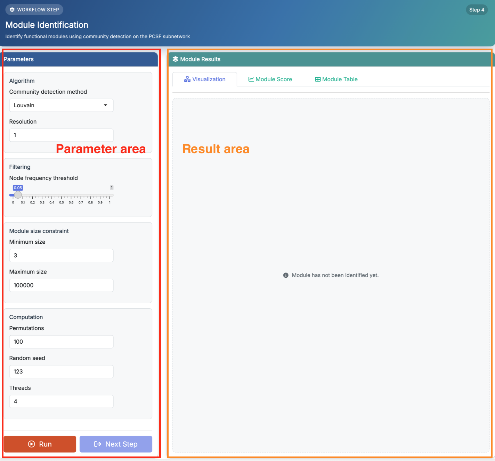
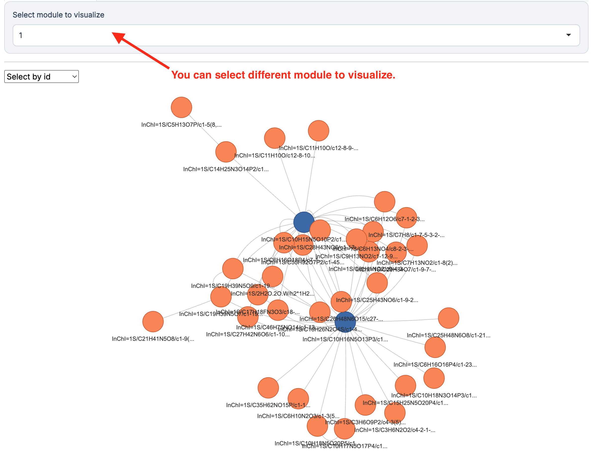
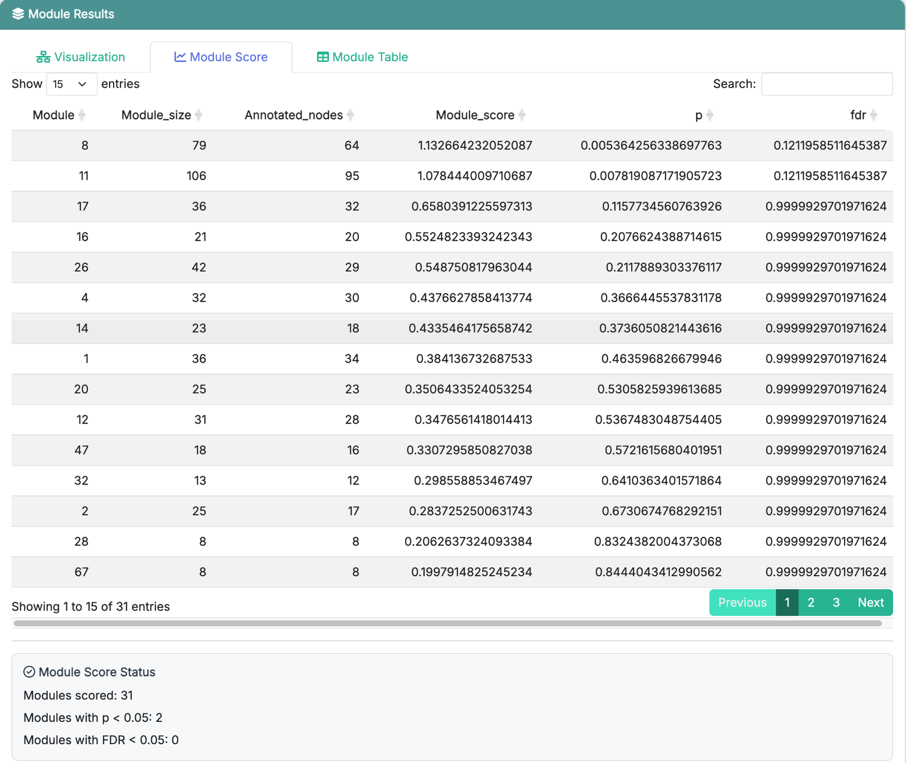
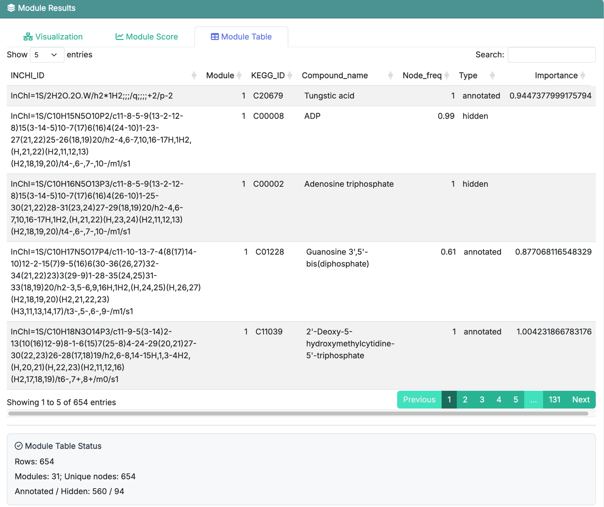

# Module Identification

This chapter focuses on how to use **Step 4: Module Identification** in **FeatureMAP Shiny**. The detailed method, parameter definitions, and result structure have already been introduced in [R package-Module Identification](05_module_identification.qmd), so here we focus on the Shiny workflow itself.

::: callout-important
**Prerequisites:** Make sure **Subnetwork Extraction** has finished successfully before starting this step.
:::

## Enter the Module Identification Page

After finishing **Subnetwork Extraction**, click **Next Step** or select **Module Identification** from the top navigation bar. This page is also divided into two areas:

-   **Parameter area** on the left: set the module identification options and click **Run**
-   **Result area** on the right: inspect the detected modules from different views

{fig-align="center" width="750"}

The purpose of this step is to identify functional modules from the extracted PCSF subnetwork.

## Parameter Area

The left panel is where you set the module identification parameters before clicking **Run**. Since the detailed meanings of these parameters have already been introduced in [R package-Module Identification](05_module_identification.qmd), we do not repeat them here.

::: callout-note
If you are running the demo data for the first time, it is usually best to keep the default settings and run the step once before tuning the algorithm or filtering thresholds.
:::

## Run Module Identification

Once the parameters are ready, click **Run**.

The app will start module identification and show a running-status modal. When the step finishes successfully, the result panel on the right will be updated automatically, and the **Next Step** button will become available.

## Result Area

### Visualization

The **Visualization** tab is used to inspect the detected modules as subnetworks.

{fig-align="center" width="750"}

After the run finishes, you can choose a module and view its network directly in the app. This is usually the most intuitive place to start, because it lets you quickly see how the selected module is organized.

### Module Score

The **Module Score** tab shows the quantitative summary for identified modules. This table is useful for checking which modules are stronger or more statistically convincing before moving on to interpretation.

{fig-align="center" width="750"}

For a full explanation of the score-related columns, see [R package-Module Identification](05_module_identification.qmd).

### Module Table

The **Module Table** tab shows the detailed module membership results. This table is the main reference when you want to inspect which metabolites were assigned to each module and what information will be passed to the next step.

{fig-align="center" width="750"}

For a full explanation of the result columns, see [R package-Module Identification](05_module_identification.qmd).

## Recommended: Run the Demo Data First

If you followed the previous chapters and loaded the built-in demo data, the recommended workflow here is:

1.  keep the default parameter settings
2.  click **Run**
3.  wait for module identification to finish
4.  open **Visualization** first to inspect the detected modules
5.  then review **Module Score**
6.  finally check **Module Table** for the detailed module membership results

This is the easiest way to understand what this step produces before tuning parameters on your own dataset.

::: callout-tip
If no module appears, first check whether **Subnetwork Extraction** finished successfully in the previous step and whether the extracted subnetwork contains enough structure for module detection.
:::

## Next Step

Once module identification is complete, click **Next Step** to continue to **AI-Powered Function Annotation**.
