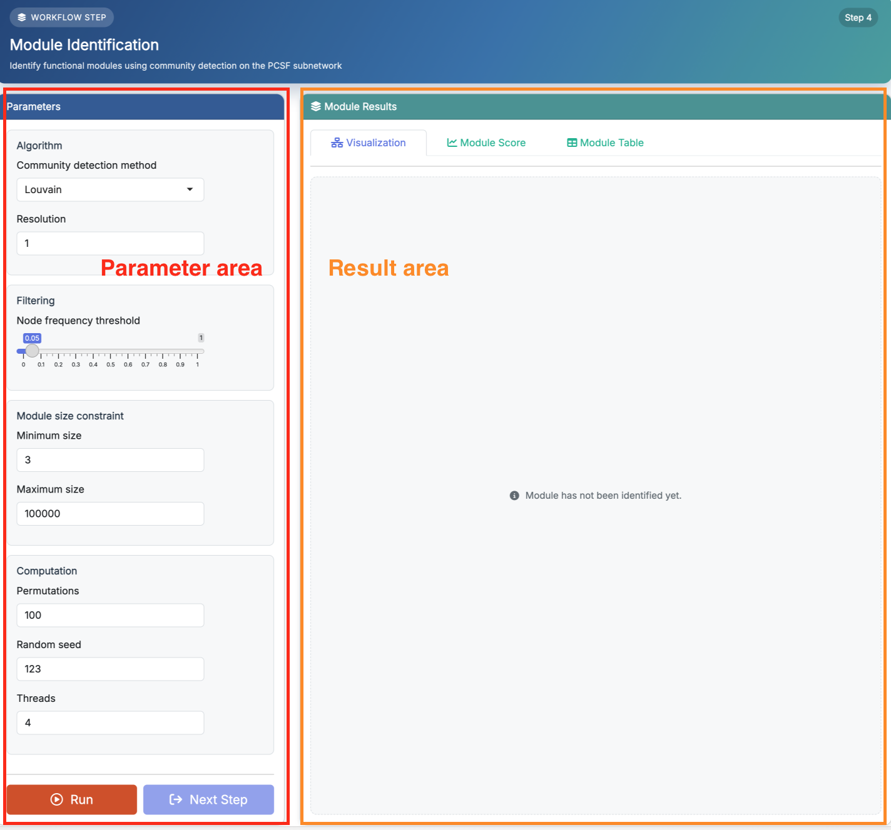

# Module Identification

This chapter focuses on how to use **Step 4: Module Identification** in **FeatureMAP Shiny**. The detailed method, parameter definitions, and result structure have already been introduced in [R package-Module Identification](05_module_identification.qmd), so here we focus on the Shiny workflow itself.

::: callout-important
**Prerequisites:** Make sure **Subnetwork Extraction** has finished successfully before starting this step.
:::

## Enter the Module Identification Page

After finishing **Subnetwork Extraction**, click **Next Step**, or open **Analysis → 4 Module Identification** in the navigation bar.

{fig-align="center" width="750"}

The purpose of this step is to identify functional modules from the extracted PCSF subnetwork.

## Parameter Area

| Section | Field | Default |
|------------------------|------------------------|------------------------|
| **Algorithm** | Community detection method (Louvain / Walktrap / Fast greedy / Leading eigen) | `Louvain` |
|  | Resolution, shown for *Louvain* | `1` |
|  | Number of steps, shown for *Walktrap* | `4` |
| **Filtering** | Node frequency threshold | `0.05` |
|  | Minimum module size | `3` |
| **Computation** | Permutations | `100` |
|  | Random seed | `123` |
|  | Threads | `4` |

The four algorithms and the effect of each threshold are described in [R package-Module Identification](05_module_identification.qmd).

::: callout-note
If you are running the demo data for the first time, it is usually best to keep the default settings and run the step once before tuning the algorithm or the filtering thresholds.
:::

## Run Module Identification

Once the parameters are ready, click **Run**.

Module detection is followed by the permutation test, so this step takes a while with the default 100 permutations. When it finishes, the result panel is updated automatically and the **Next Step** button becomes available.

## Result Area

### Visualization

The **Visualization** tab shows one detected module at a time as a network.

{fig-align="center" width="750"}

Two selectors sit above the plot:

-   the **Module** selector chooses which module (`M1`, `M2`, ...) to display
-   the **Metabolite** selector highlights one metabolite and its directly connected neighbours inside that module

The legend distinguishes **Annotated** metabolites (green), which are linked to observed LC--MS features, from **Hidden** metabolites (red), which are Steiner nodes added during PCSF optimization to keep the module connected.

### Module Score

The **Module Score** tab shows the quantitative summary for every detected module: size, number of annotated nodes, module score, permutation p-value and FDR. This table tells you which modules are worth interpreting in the next step.

{fig-align="center" width="750"}

### Module Table

The **Module Table** tab shows the detailed module membership: which metabolite belongs to which module, its HMDB and KEGG identifiers, node frequency, type and importance.

{fig-align="center" width="750"}

For a full explanation of the columns in both tables, see [R package-Module Identification](05_module_identification.qmd).

## Recommended: Run the Demo Data First

If you followed the previous chapters and loaded the built-in demo data, the recommended workflow here is:

1.  keep the default parameter settings
2.  click **Run**
3.  wait for module identification and the permutation test to finish
4.  open **Visualization** first to inspect the detected modules
5.  then review **Module Score** to see which modules are significant
6.  finally check **Module Table** for the detailed module membership results

This is the easiest way to understand what this step produces before tuning parameters on your own dataset.

::: callout-tip
If no module appears, first check whether **Subnetwork Extraction** finished successfully and whether the extracted subnetwork contains enough structure for community detection. Lowering **Minimum module size** or the **Node frequency threshold** keeps more of the network in play.
:::

## Next Step

Once module identification is complete, click **Next Step** to continue to **Function Interpretation**.
