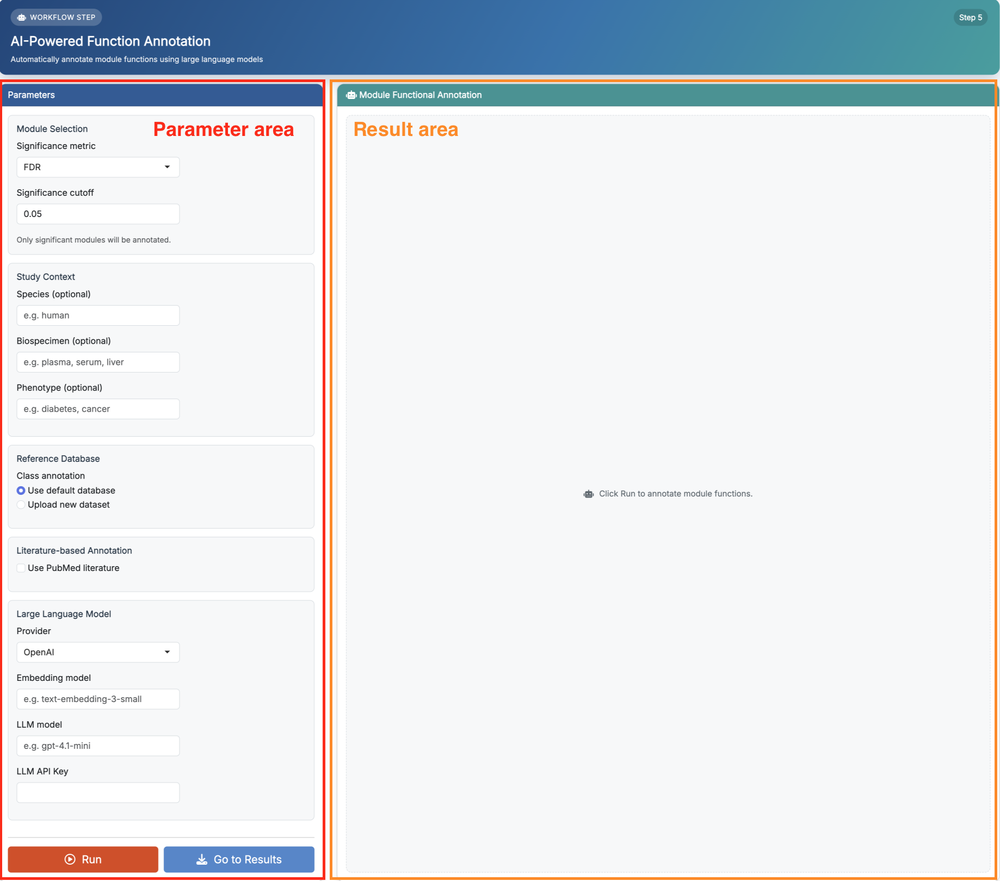

# Function Annotation

This chapter focuses on how to use **Step 5: AI-Powered Function Annotation** in **FeatureMAP Shiny**. The detailed method, parameter definitions, and result structure have already been introduced in [R package-Function Annotation](06_function_annotation.qmd), so here we focus on the Shiny workflow itself.

::: callout-important
**Prerequisites:** Make sure **Module Identification** has finished successfully before starting this step.
:::

## Enter the Function Annotation Page

After finishing **Module Identification**, click **Next Step** or select **Function Annotation** from the top navigation bar. This page is also divided into two areas:

-   **Parameter area** on the left: set the module filtering and annotation options, then click **Run**
-   **Result area** on the right: inspect the module-level biological interpretation results

{fig-align="center" width="750"}

The purpose of this step is to generate interpretable biological summaries for significant modules using database knowledge, optional PubMed evidence, and a large language model.

## Parameter Area

The left panel is where you set the function annotation parameters before clicking **Run**. Since the detailed meanings of these parameters have already been introduced in [R package-Function Annotation](06_function_annotation.qmd), we do not repeat them here.

The main point to remember is:

-   you can run this step with database information plus LLM interpretation
-   you can optionally enable **PubMed literature** for additional evidence
-   you must provide a valid **LLM API key**
-   if PubMed is enabled, you should also provide an **NCBI API key**

::: callout-note
If you are running the demo data for the first time, it is usually best to start with a simple configuration first, then enable PubMed-based annotation later if needed.
:::

## Run Function Annotation

Once the parameters are ready, click **Run**.

The app will start module function annotation and show a running-status modal. When the step finishes successfully, the result panel on the right will be updated automatically.

If no significant modules pass the selected cutoff, the app will finish normally but return an empty result for this step.

## Result Area

After the run finishes, the right panel shows the annotation result for one selected module at a time.

{fig-align="center" width="750"}

If literature-based annotation was enabled, the page also shows a **Literature Evidence (PMID)** section for the selected module. This section helps you inspect which literature evidence was retained and gives you a quick way to open the corresponding PubMed records.

## Recommended: Run the Demo Data First

If you followed the previous chapters and loaded the built-in demo data, the recommended workflow here is:

1.  keep the default significance settings
2.  start with the default reference database
3.  provide the required LLM settings and API key
4.  leave **Use PubMed literature** off for the first test run if you want a simpler setup
5.  click **Run**
6.  review the generated title, summary, confidence, and rationale for each module

This is the easiest way to understand what this step produces before running a more complete literature-supported annotation on your own dataset.

::: callout-tip
If this step returns no results, first check whether any significant modules were detected in **Module Identification** under your current cutoff.
:::

## Next Step

Once function annotation is complete, go to **Results** to download the generated tables and networks.
