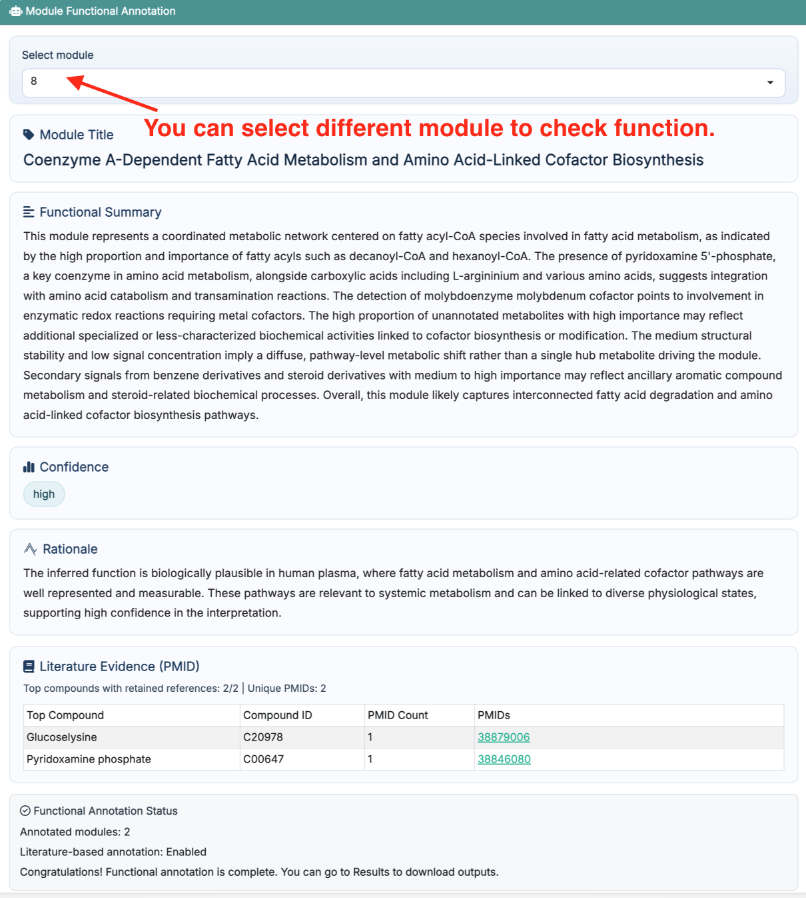
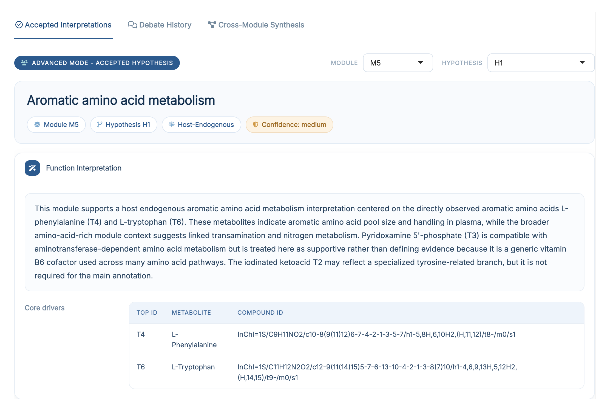
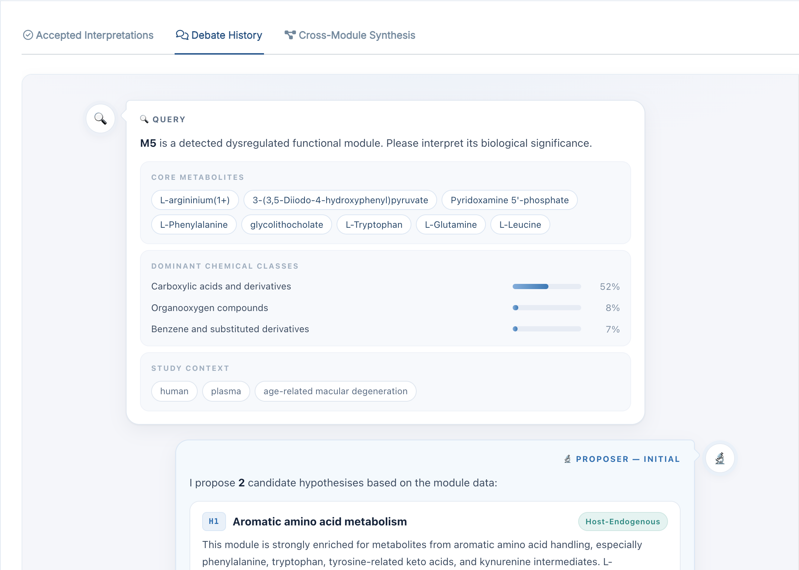
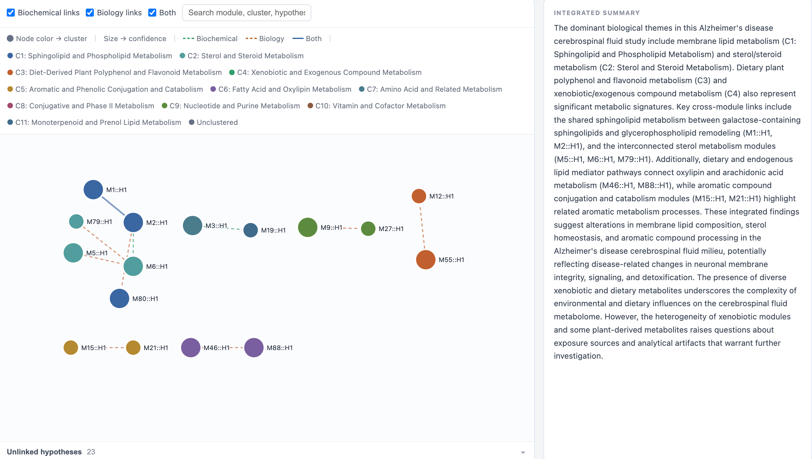

# Function Interpretation

This chapter focuses on how to use **Step 5: Function Interpretation** in **FeatureMAP Shiny**. The detailed method, parameter definitions, and result structure have already been introduced in [R package-Function Annotation](06_function_annotation.qmd), so here we focus on the Shiny workflow itself.

::: callout-important
**Prerequisites:** Make sure **Module Identification** has finished successfully before starting this step.
:::

## Enter the Function Interpretation Page

After finishing **Module Identification**, click **Next Step**, or open **Analysis → 5 Function Interpretation** in the navigation bar.

{fig-align="center" width="750"}

The purpose of this step is to turn statistically supported modules into interpretable biology, using the module's own metabolite evidence, optional PubMed literature, and a large language model.

## Parameter Area

| Section | Field | Default |
|------------------------|------------------------|------------------------|
| **Module Selection** | Significance metric (p-value / FDR) | `FDR` |
|  | Significance cutoff | `0.05` |
| **Annotation Mode** | Fast / Advanced | `Fast` |
| **Study Context** | Species, Biospecimen, Phenotype | empty |
| **Literature** | Use PubMed literature | off |
|  | Years to search, NCBI API key | `5` |
| **Large Language Model** | Provider (OpenAI / Google Gemini / SiliconFlow / Local) | `OpenAI` |
|  | Model ID | empty |
|  | Local base URL, shown for *Local* | empty |
|  | API key | empty |

::: callout-important
**Demo data: switch the metric to p-value.** With the demo dataset, no module reaches `FDR < 0.05` and exactly one module passes `p-value < 0.05`. If you keep the default **FDR**, the run finishes normally but reports that no module passed the cutoff. Set **Significance metric** to **p-value** to interpret that one module. The same caveat and its explanation are given in [R package-Module Identification](05_module_identification.qmd).
:::

::: callout-important
**Model ID** must be a chat model name that the selected provider actually offers, for example `gpt-4.1-mini` for OpenAI. The ⓘ icon next to the section title links to each provider's model list. `Local` targets any OpenAI-compatible endpoint (such as a self-hosted server), needs a **Local base URL**, and works without an API key.
:::

::: callout-note
**Study Context** is optional but strongly recommended: species, biospecimen and phenotype are what turn a generic biochemical description into an interpretation of *your* study. The phenotype is also used as the query context when PubMed retrieval is enabled.
:::

## Fast Mode and Advanced Mode

The **Annotation Mode** switch chooses between the two pipelines described in [R package-Function Annotation](06_function_annotation.qmd):

-   **Fast** -- a two-call pipeline producing one interpretation per module. This is the cheaper and faster option, and the right one for a first pass.
-   **Advanced** -- a multi-agent debate: a Proposer drafts 1--3 candidate hypotheses, a Skeptic challenges them over up to two rounds, and an Arbiter accepts or rejects each one.

::: callout-tip
In the app, Advanced mode is not a set of separate options: the per-module **debate transcript** and the **cross-module synthesis** are always produced as part of an Advanced run, and appear as their own result tabs.
:::

## Run Function Interpretation

Once the parameters are ready, click **Run**.

The app calls the model module by module, so this step is the slowest one and its runtime grows with the number of significant modules, with Advanced mode, and with PubMed enabled. If no module passes the selected cutoff, the run finishes normally and the result panel reports that nothing passed.

::: callout-note
API keys are entered per session and are used only for the current run; they are not stored in your results.
:::

## Result Area (Fast Mode)

In Fast mode the right panel shows one module at a time, chosen with the module selector in the toolbar.

{fig-align="center" width="750"}

Each report opens with the module title and a row of pills -- module ID, hypothesis type, and confidence -- followed by five sections:

| Section | Content |
|-------------------------|-----------------------------------------------|
| **Function Interpretation** | The functional summary, plus the core driver (anchor) metabolites behind it |
| **Biochemical Context** | Chemical-class profile, KEGG and HMDB pathway coverage, and the endogenous/exogenous origin profile |
| **Module Statistics** | The supporting metabolites of the module and the global direction of change |
| **Phenotype & Literature** | The phenotype relationship, plus clickable PMID links when PubMed was enabled |
| **Evidence Strength** | The confidence label and the rationale behind it |

## Result Area (Advanced Mode)

In Advanced mode the right panel has three tabs.

### Accepted Interpretations

{fig-align="center" width="750"}

The same report layout as Fast mode, but with two selectors: one for the module and one for the **accepted hypothesis** within that module. A module can therefore carry more than one accepted interpretation.

### Debate History

{fig-align="center" width="750"}

An embedded chat-style transcript of the debate for the selected module, showing the Proposer, Skeptic and Arbiter turns in order. This is where you see *why* a hypothesis survived or was rejected. It is the same page that `export_debate_html()` writes in the R package.

### Cross-Module Synthesis

{fig-align="center" width="750"}

An interactive network integrating the accepted hypotheses from all modules into thematic clusters, with links that are either proposed by the model from the hypothesis summaries or computed deterministically from metabolic-network edges and pathway overlap. It corresponds to `res$module_synthesis` and to `export_synthesis_network_html()` in the R package.

Each node is one accepted hypothesis, named `<module>::<hypothesis>`; node colour marks the thematic cluster and node size the confidence. The checkboxes above the plot switch between **Biochemical links**, **Biology links** and links supported by **Both**, and the panel on the right holds the integrated summary written across all modules. Hypotheses without any cross-module link are collected under **Unlinked hypotheses** at the bottom.

::: callout-note
**The screenshot above does not come from the demo data.** A cross-module synthesis only becomes meaningful when several modules carry accepted hypotheses, and the demo dataset yields a single significant module, which leaves nothing to link. The screenshot therefore shows an Advanced run on a larger real dataset, so that the clusters, the cross-module links and the integrated summary are visible. With the demo data this tab still opens, but it shows one node and no links.
:::

Both HTML reports can be exported on the **Results Download** page.

## Recommended: Run the Demo Data First

If you followed the previous chapters and loaded the built-in demo data, the recommended workflow here is:

1.  set **Significance metric** to **p-value** and keep the cutoff at `0.05` -- with the demo data nothing passes FDR
2.  fill in **Study Context** with the species, biospecimen and phenotype of your study
3.  start in **Fast** mode, with **Use PubMed literature** off, so the first run is quick and cheap
4.  provide the LLM provider, model ID and API key
5.  click **Run** and review the generated title, summary, confidence and rationale
6.  once the setup works, re-run the modules you care about in **Advanced** mode, with PubMed enabled

::: callout-tip
If this step returns no results, first check whether any module passed the cutoff in **Module Identification**. If the run fails immediately, check the model ID and the API key -- an unknown model name for the selected provider is the most common cause.
:::

## Next Step

Once function interpretation is complete, click **Results** to download the generated tables, networks and reports.
