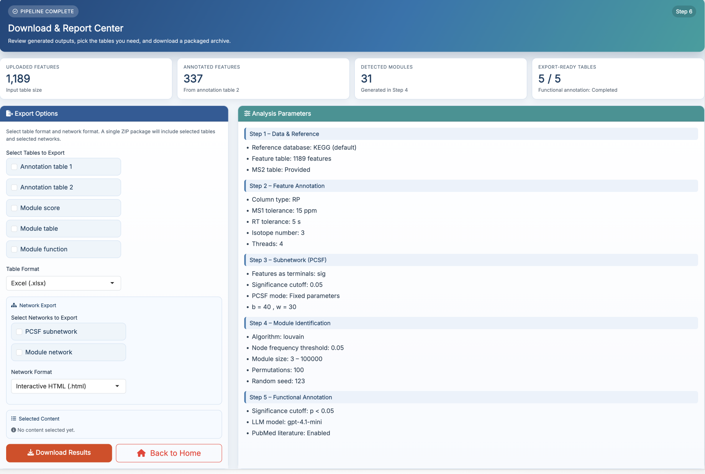
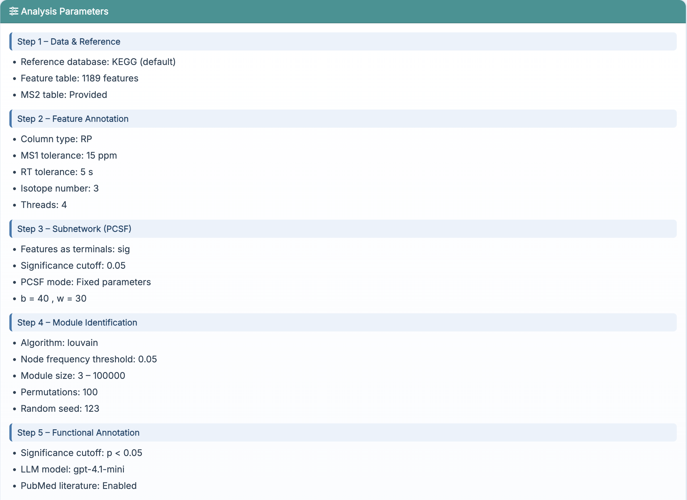
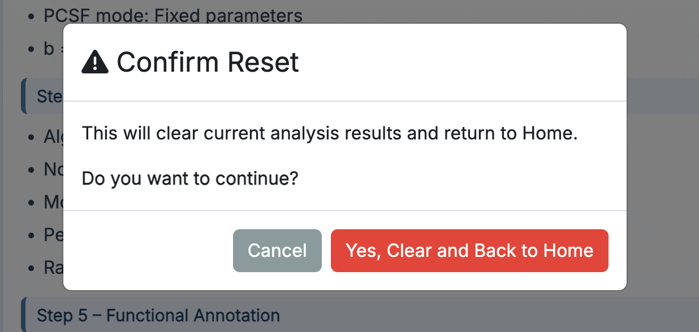

# Results Export

This chapter focuses on how to use **Step 6: Results** in **FeatureMAP Shiny**. This page is the final export center of the Shiny workflow, where you can review the overall run summary, choose which outputs to export, and download them as a compressed package.

::: callout-important
**Prerequisites:** At least part of the workflow should have finished successfully before this page becomes useful. The more steps you complete, the more export-ready content will appear here.
:::

## Enter the Results Page

After finishing **AI-Powered Function Annotation**, click **Go to Results** or select **Results** from the top navigation bar.

{fig-align="center" width="750"}

## Summary Cards

At the top of the page, a row of small summary cards gives a quick overview of the current run. These cards summarize key information such as:

-   how many features were uploaded
-   how many features were retained in the refined annotation results
-   how many modules were detected
-   how many tables are currently export-ready

This section is useful for quickly checking whether the full workflow has run as expected before exporting anything.

## Export Options

The left panel is where you choose what to export.Here you can:

-   select which result tables to include
-   choose the table export format
-   choose whether to export network outputs
-   choose the network export format

The app packages the selected outputs into a single compressed archive for download.

## Selected Content Preview

Inside the **Export Options** panel, the app also shows a **Selected Content** preview.

{fig-align="center" width="450"}

This preview helps you confirm:

-   what you selected
-   whether each item is ready
-   whether anything is still unavailable because an earlier step has not finished yet

Only items that are ready can be successfully downloaded.

## Analysis Parameters

The right panel contains an **Analysis Parameters** card that summarizes key settings used in the current run. This panel provides a compact record of major settings from:

{fig-align="center" width="750"}

This is helpful when you want to double-check what settings were used before exporting results or preparing a report.

## Back to Home

The **Back to Home** button returns the app to the Home page after confirmation.

{fig-align="center" width="450"}

Before returning, the app clears the current analysis results stored in the running session, so you can start a new analysis from a clean state.

::: callout-note
This action clears the current in-app analysis state. It does not delete files that you have already downloaded to your own computer.
:::

## Recommended Export Workflow

For most users, the recommended workflow on this page is:

1.  check the summary cards at the top
2.  choose the result tables you want to keep
3.  choose the export format
4.  optionally include network outputs
5.  confirm readiness in **Selected Content**
6.  click **Download Results**
7.  click **Back to Home**

This gives you a clean backup of the current run in one compressed file.
