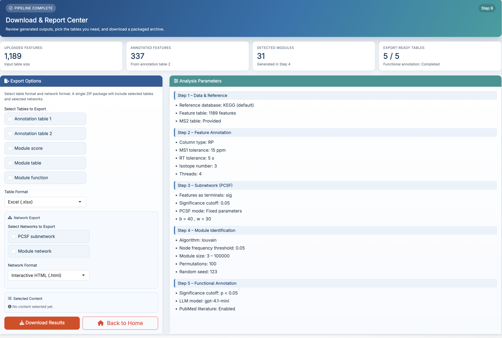
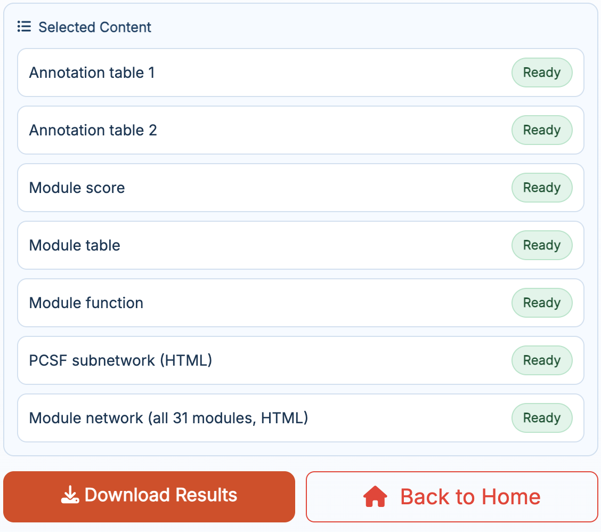
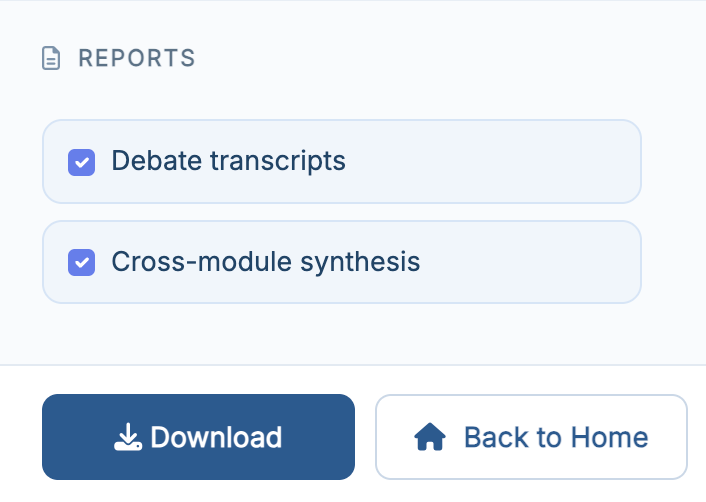
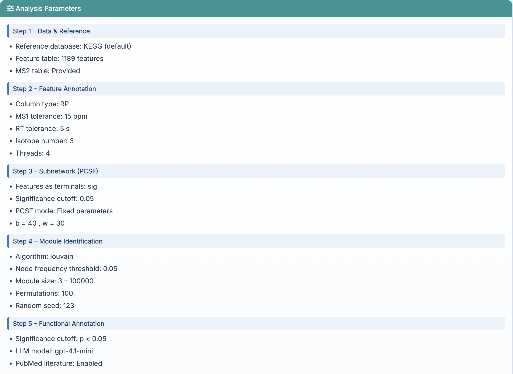
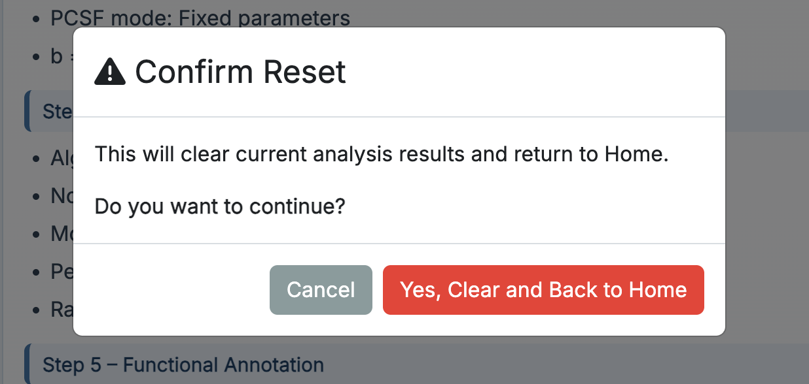

# Results Download

This chapter focuses on how to use **Step 6: Results Download** in **FeatureMAP Shiny**. This page is the export center of the workflow, where you review the run, choose which outputs to keep, and download them as a single compressed archive.

::: callout-important
**Prerequisites:** At least part of the workflow should have finished successfully before this page becomes useful. The more steps you complete, the more export-ready content will appear here.
:::

## Enter the Results Page

After finishing **Function Interpretation**, click **Results**, or open **Analysis → 6 Results Download** in the navigation bar.

{fig-align="center" width="750"}

## Summary Cards

At the top of the work area, four cards summarize the current run:

-   **Uploaded Features** -- the size of the input feature table
-   **Annotated Features** -- how many features survived into the network-refined annotation table
-   **Detected Modules** -- how many modules were found in Step 4
-   **Annotated Modules** -- how many significant modules were interpreted, out of how many passed the cutoff, together with the metric and mode used (for example `FDR < 0.05 (Advanced)`)

This is a quick way to check that the workflow ran as expected before exporting anything.

## Export Options

The left panel is where you choose what to export.

{fig-align="center" width="450"}

**Tables** -- Annotation table 1, Annotation table 2, Module score, Module table, Module function. Everything that is ready is ticked for you, and the **Table format** selector offers Excel (`.xlsx`), CSV (one file per table) or `RData`.

**Networks** -- the PCSF subnetwork and the module networks. When **Module network** is selected, an extra selector lets you export all modules or only the ones you choose. The **Network format** selector offers interactive HTML or GraphML for use in Cytoscape or igraph.

**Reports** -- this section appears only after an **Advanced** mode run in Step 5, and offers the **Debate transcripts** and the **Cross-module synthesis** network as standalone HTML pages.

{fig-align="center" width="450"}

Items that are not ready yet, because the corresponding step has not been run, cannot be selected. Clicking **Download** packages everything you selected into one zip archive.

## Analysis Parameters

The right panel contains an **Analysis Parameters** card that records the settings used in the current run, one block per step:

{fig-align="center" width="750"}

-   **Data & Reference** -- reference database used, feature table size, whether an MS2 table was provided
-   **Feature Annotation** -- column type, MS1 and RT tolerance, isotope number, threads
-   **Subnetwork (PCSF)** -- terminal selection and cutoff, fixed `b / w` or the best pair found by grid tuning
-   **Module Identification** -- algorithm, node frequency threshold, minimum module size, permutations, seed
-   **Function Interpretation** -- mode, significance cutoff, LLM provider and model

Steps that have not been run are shown as pending. This card is the record to keep alongside your exported files when you write up the analysis.

## Back to Home

The **Back to Home** button returns the app to the Home page after confirmation.

{fig-align="center" width="450"}

Before returning, the app clears the analysis results held in the current session, so you can start a new analysis from a clean state.

::: callout-note
This action clears the in-app analysis state only. It does not delete files that you have already downloaded to your own computer, so download what you need first.
:::

## Recommended Export Workflow

For most users, the recommended workflow on this page is:

1.  check the four summary cards at the top
2.  confirm the result tables you want to keep and choose the table format
3.  add the networks you want, and pick which modules to include
4.  for an Advanced run, add the debate transcripts and the cross-module synthesis under **Reports**
5.  review the **Analysis Parameters** card
6.  click **Download**
7.  click **Back to Home** when you are ready to start a new analysis

This gives you a clean, reproducible backup of the current run in one compressed file.
