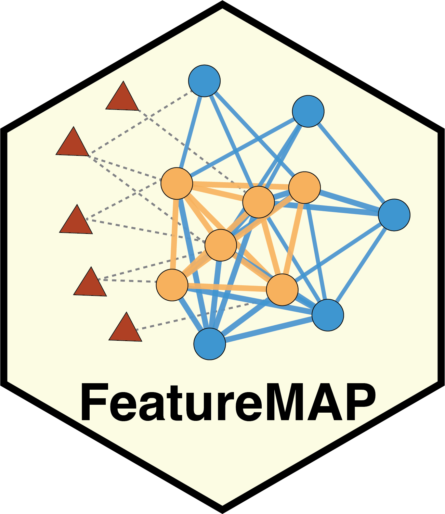

<p align="center">
  
</p>

# FeatureMAP Tutorial

A practical guide to network-guided discovery and interpretation of
dysregulated metabolic modules from untargeted metabolomics data.

**[Read the tutorial online](https://tidymass.github.io/featuremap_tutorial/)** ·
**[View the R package](https://github.com/tidymass/featuremap)**

## About the tutorial

FeatureMAP turns feature-level metabolomics signals into interpretable
metabolic modules. This tutorial covers the complete workflow through two
complementary interfaces:

- **R package:** a reproducible, code-based workflow for analysis and custom
  pipelines.
- **Shiny app:** a guided, point-and-click workflow for interactive analysis
  and result exploration.

Both tracks follow the same analysis logic:

1. Prepare the feature and optional MS2 annotation tables.
2. Annotate metabolite features.
3. Extract a network-supported metabolic subnetwork.
4. Identify and evaluate functional modules.
5. Interpret significant modules and export the results.

## Tutorial contents

| Track | Topics |
|---|---|
| **R package** | Installation, data preparation, feature annotation, PCSF subnetwork extraction, module identification, and functional annotation |
| **Shiny app** | Installation, data upload, interactive execution of each analysis step, result inspection, and export |

The functional annotation chapter also introduces optional PubMed retrieval,
LLM-assisted interpretation, advanced multi-agent debate, and cross-module
synthesis. These services are optional and are not required for the earlier
analysis steps.

## Getting started

For most users, the easiest entry point is the
**[online tutorial](https://tidymass.github.io/featuremap_tutorial/)**.

To begin with the R package, follow the
**[installation chapter](https://tidymass.github.io/featuremap_tutorial/01_package_installation.html)**.
The four main FeatureMAP analysis functions are:

```r
res <- annotate_feature(...)
res <- extract_subnetwork(res = res, ...)
res <- identify_module(res = res, ...)
res <- annotate_module(res = res, ...)
```

Complete input specifications, parameter explanations, and output examples are
provided in the corresponding tutorial chapters.

## Preview locally

This tutorial is written as a [Quarto](https://quarto.org/) book. After cloning
the repository, preview it locally with:

```bash
git clone https://github.com/tidymass/featuremap_tutorial.git
cd featuremap_tutorial
quarto preview
```

Render the complete website with:

```bash
quarto render
```

The rendered site is written to `docs/`. GitHub Pages is configured to publish
that directory from the `main` branch.

## Repository structure

- `index.qmd` — tutorial preface and overview
- `01_`–`06_*.qmd` — R package workflow
- `10_`–`16_*.qmd` — Shiny app workflow
- `images/` — screenshots and tutorial images
- `_quarto.yml` — book structure and rendering configuration
- `docs/` — rendered GitHub Pages website

## Citation

To obtain the current FeatureMAP citation from R, run:

```r
citation("featuremap")
```

The associated manuscript is currently in preparation:

> **FeatureMAP enables network-guided discovery and interpretation of
> dysregulated metabolic modules from untargeted metabolomics.**

## Authors and support

FeatureMAP is developed by
[Yuting Wang](https://ytwangzero.github.io/) and
[Xiaotao Shen](https://www.jaspershenlab.com/).

For questions, documentation corrections, or feature requests, please
[open an issue](https://github.com/tidymass/featuremap_tutorial/issues).
